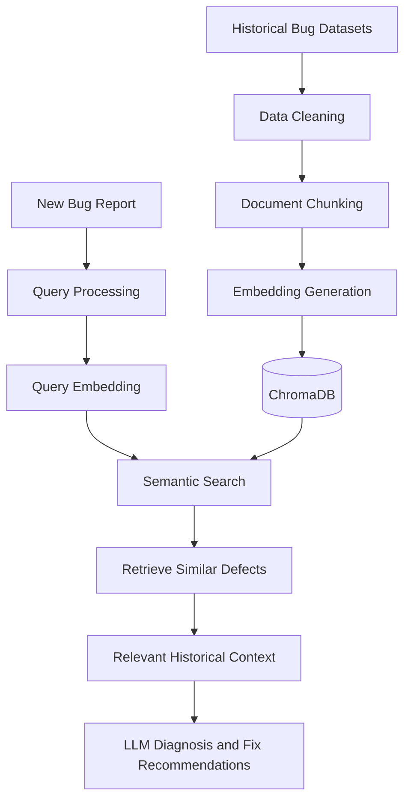

Historical Defect Knowledge Base Design

Intelligent Bug Diagnosis Platform with Fix Recommendation Assistance

1. Introduction

The Historical Defect Knowledge Base is designed to store and organize previously reported software defects and their resolutions.

It will serve as the information source for the platform's Retrieval-Augmented Generation (RAG) pipeline.

The initial dataset sources are:

- Mozilla
- Apache
- Eclipse

Publicly available historical defect datasets will be collected and analyzed for knowledge base construction.

2. Knowledge Base Objectives

- Collect historical software defect reports.
- Clean and standardize defect information.
- Divide bug reports into meaningful chunks.
- Generate semantic embeddings.
- Store embeddings in a vector database.
- Retrieve similar historical defects.
- Provide relevant historical context for bug diagnosis and fix recommendations.

3. Historical Defect Data Sources

Dataset source| Information to collect
Mozilla| Bug descriptions, comments, statuses and resolutions
Apache| Issue descriptions, technical details and resolutions
Eclipse| Bug summaries, descriptions, comments and resolution details

The exact datasets, formats, available fields, and licenses will be verified before downloading and processing.

4. Historical Defect Data Structure

Each historical defect will be represented using a structured format.

Proposed defect schema:

Field| Description
bug_id| Unique defect identifier
source_project| Mozilla, Apache or Eclipse
summary| Short bug description
description| Detailed problem explanation
stack_trace| Associated stack trace, if available
comments| Developer discussions
resolution| Recorded resolution, if available
status| Current or final defect status
created_date| Bug creation date
updated_date| Last modification date

5. Data Cleaning and Standardization

Raw historical defect reports may contain duplicated information, incomplete fields, irrelevant text, and inconsistent formats.

The cleaning process will include:

1. Remove duplicate defect records.
2. Handle missing or empty fields.
3. Normalize text formatting.
4. Remove irrelevant HTML tags and formatting.
5. Standardize field names.
6. Preserve important technical information.
7. Separate descriptions, stack traces, comments, and resolutions.
8. Retain source identifiers and original references.

Important technical details such as exception names, file paths, function names, and error messages should be preserved.

6. Document Chunking Strategy

Large bug reports will be divided into smaller meaningful text sections called chunks.

The proposed chunking strategy is based on the structure of bug reports.

Chunk type| Content
Summary chunk| Short bug description
Description chunk| Detailed explanation of the defect
Stack trace chunk| Exception details and error locations
Comment chunk| Relevant developer discussions
Resolution chunk| Recorded fix or solution

Example:

Original bug report:

- Summary: Application crashes during file upload.
- Description: Application terminates when uploading large files.
- Stack trace: OutOfMemoryError.
- Resolution: Memory allocation issue corrected.

Possible chunks:

1. Application crashes during file upload.
2. Application terminates when uploading large files.
3. OutOfMemoryError.
4. Memory allocation issue corrected.

Each chunk will retain metadata linking it to its original defect.

The chunking process should preserve relationships between related sections rather than treating them as unrelated bug reports.

7. Embedding Generation

After chunking, each text chunk will be converted into a numerical vector called an embedding.

Proposed model: Sentence Transformers - all-MiniLM-L6-v2.

The model converts text into 384-dimensional vector representations.

These vectors help identify semantic relationships between different bug reports, even when they use different words to describe similar problems.

Example:

- Bug A: Application crashes while uploading a file.
- Bug B: Program terminates during file transfer.

Although the wording differs, their meanings may be semantically similar.

8. Vector Database and Indexing

Proposed vector database: ChromaDB.

ChromaDB will store:

- Generated embeddings
- Original text chunks
- Bug identifiers
- Project source
- Chunk types
- Resolution metadata

Each stored chunk will be associated with its original historical defect.

Proposed metadata structure:

{
  "bug_id": "MOZ-1001",
  "source_project": "Mozilla",
  "chunk_type": "description",
  "status": "resolved",
  "resolution": "Memory allocation issue corrected"
}

The example above is illustrative, not an actual collected defect record.

9. Semantic Retrieval Process

When a developer submits a new bug report:

1. The submitted report is processed.
2. An embedding is generated using the same embedding model.
3. The query embedding is compared with stored historical embeddings.
4. Similar defect chunks are retrieved.
5. Results are ranked by semantic similarity.
6. Relevant historical descriptions and resolutions are provided to the RAG pipeline.

Cosine similarity is proposed as the initial similarity measurement technique.

10. RAG Integration

The knowledge base will support the following RAG workflow:

The retrieved historical information will provide context for the AI agents during diagnosis.

11. Knowledge Base Update Strategy

The system will support future knowledge base updates.

Proposed update process:

1. Identify newly available historical defect records.
2. Validate and clean the records.
3. Check for duplicate entries.
4. Generate chunks and embeddings.
5. Store new vectors with metadata.
6. Maintain source references and identifiers.

Only validated information should be added to the knowledge base.

12. Proposed Technology Stack

Component| Technology
Dataset Processing| Python, Pandas
Text Cleaning| Python
Chunking| Custom Python processing
Embedding Model| Sentence Transformers
Vector Database| ChromaDB
Similarity Measurement| Cosine Similarity
RAG Pipeline| Python, LangChain (optional)
LLM Runtime| Ollama

13. Evaluation Strategy

The knowledge base and retrieval pipeline will be evaluated using:

- Retrieval relevance
- Precision@K
- Recall@K
- Similarity ranking quality
- Retrieval response time
- Correct association between chunks and original defect records

Evaluation will use manually reviewed bug-query examples and their relevant historical defects.

14. Current Status

This document defines the proposed design for the Historical Defect Knowledge Base.

Dataset collection, cleaning, chunking, embedding generation, ChromaDB indexing, and retrieval evaluation are planned implementation activities for Milestone 1.
