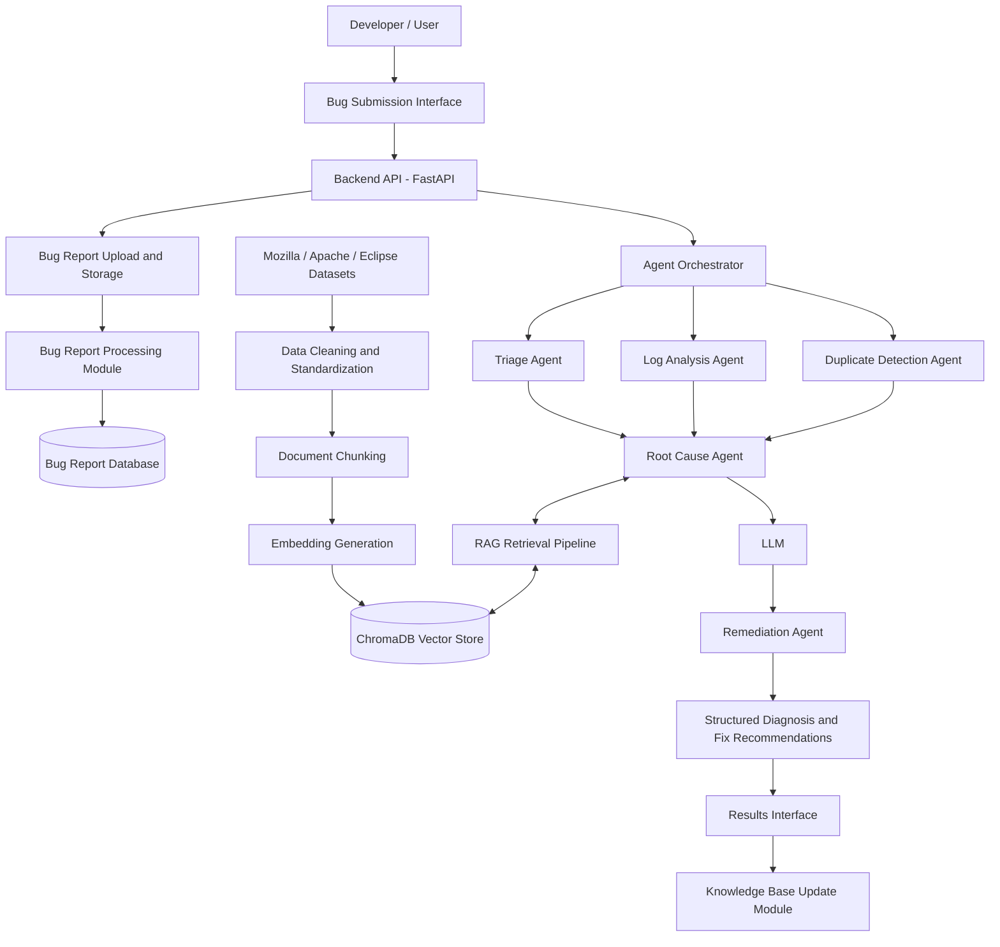

System Architecture

Intelligent Bug Diagnosis Platform with Fix Recommendation Assistance

1. Introduction

The Intelligent Bug Diagnosis Platform is designed to analyze software bug reports, identify potential root causes, retrieve similar historical defects, and recommend possible fixes.

The proposed system combines Retrieval-Augmented Generation (RAG), semantic similarity, vector search, and a multi-agent architecture.

2. High-Level System Architecture

3. Architecture Components

3.1 Bug Submission Interface

- Provides an interface for submitting software bug reports.
- Supports direct text input.
- Accepts stack traces and error logs.
- Supports uploading supported report and log files.

3.2 Backend API Layer

- Built using Python and FastAPI.
- Handles frontend requests.
- Validates incoming bug reports.
- Coordinates processing and storage operations.

3.3 Bug Report Processing Module

- Extracts relevant information from submitted reports.
- Cleans and standardizes bug descriptions.
- Identifies error messages and stack traces.
- Prepares structured data for diagnosis.

3.4 Bug Report Database

Stores submitted bug information, including:

- Bug ID
- Bug description
- Stack trace
- Error logs
- Submission timestamp
- Processing status

3.5 Historical Defect Knowledge Base

Contains historical software defect information collected from public Mozilla, Apache, and Eclipse datasets.

The knowledge base provides historical information for similarity-based bug retrieval.

3.6 Data Cleaning and Chunking Pipeline

- Removes irrelevant or duplicated content.
- Standardizes bug report fields.
- Separates descriptions, stack traces, comments, and resolutions.
- Divides documents into meaningful chunks.

3.7 Embedding Generation Module

Uses Sentence Transformers to convert textual bug information into numerical vector representations.

These embeddings capture semantic relationships between bug reports.

3.8 Vector Database

ChromaDB is proposed for storing embeddings and associated metadata.

It enables semantic similarity searches to retrieve historically related defects.

3.9 RAG Retrieval Pipeline

- Converts new bug information into embeddings.
- Searches the historical defect knowledge base.
- Retrieves relevant bug reports and resolutions.
- Provides contextual information to the diagnosis process.

3.10 AI Agent Layer

The system proposes five specialized agents:

1. Triage Agent
2. Log Analysis Agent
3. Root Cause Agent
4. Duplicate Detection Agent
5. Remediation Agent

The Agent Orchestrator coordinates their execution and information exchange.

3.11 LLM

The Large Language Model uses submitted bug information and retrieved historical context to support diagnosis and fix recommendations.

3.12 Results and Recommendations Interface

Displays:

- Bug classification
- Error analysis
- Possible root cause
- Similar historical bug reports
- Recommended fixes

3.13 Knowledge Base Update Module

Supports adding verified historical defect information to the knowledge base for future retrieval.

4. System Data Flow

1. The developer submits a bug report through the interface.
2. The backend validates and processes the report.
3. Structured information is stored in the bug report database.
4. The Agent Orchestrator coordinates the diagnosis workflow.
5. The RAG pipeline retrieves similar historical defects from the vector database.
6. Specialized agents analyze the submitted information.
7. The LLM supports root cause analysis and fix recommendations.
8. The final diagnosis is displayed to the developer.
9. Verified new defect information can be considered for knowledge base updates.

5. Proposed Technology Stack

Component| Technology
Frontend| React.js
UI Styling| Tailwind CSS
Backend| Python, FastAPI
Data Processing| Pandas
Embedding Model| Sentence Transformers
Vector Database| ChromaDB
RAG Framework| LangChain (optional)
LLM Runtime| Ollama
Database| SQLite
Version Control| Git, GitHub
Testing| Pytest

6. Design Considerations

- Modular architecture for easier maintenance.
- Separation of data processing and diagnosis responsibilities.
- Reusable embedding and retrieval pipelines.
- Scalable historical defect storage.
- Validation of submitted files.
- Verification of fix recommendations before presenting them as confirmed solutions.

7. Current Status

This document describes the proposed system architecture for Milestone 1. Individual modules will be implemented, integrated, and tested progressively.
